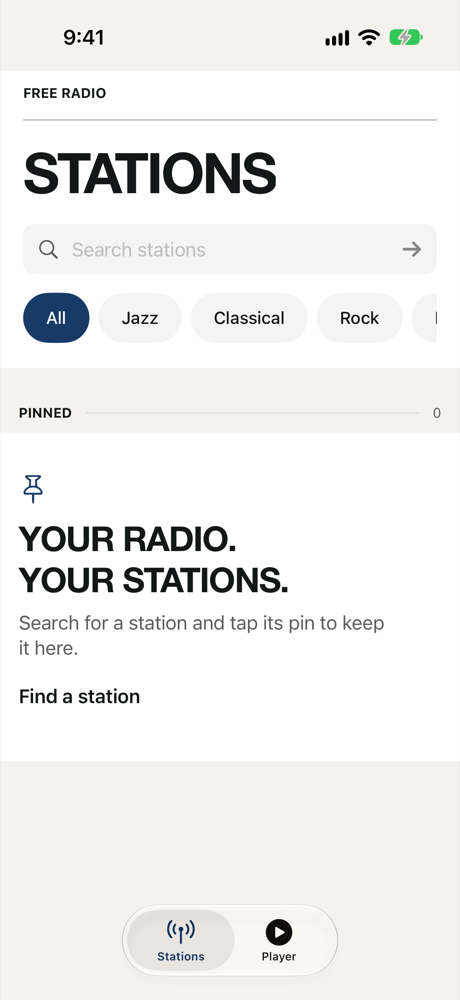
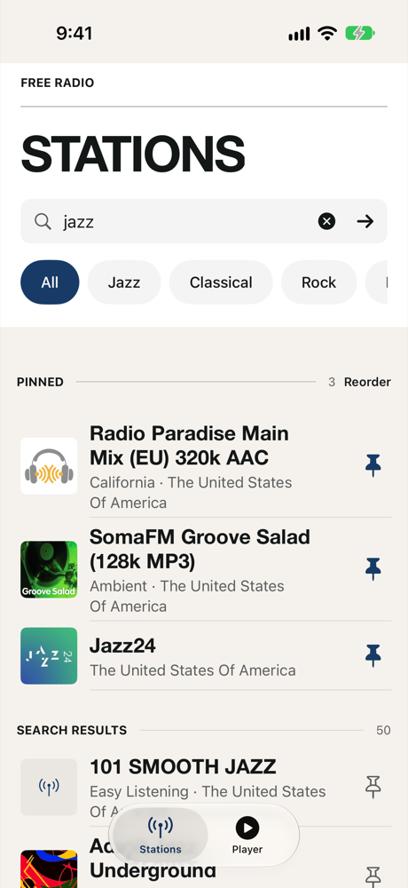
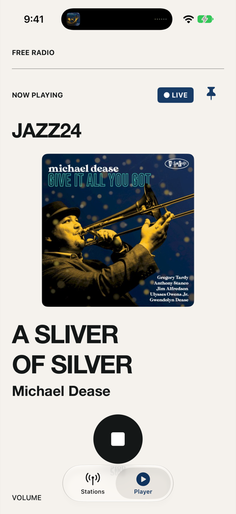
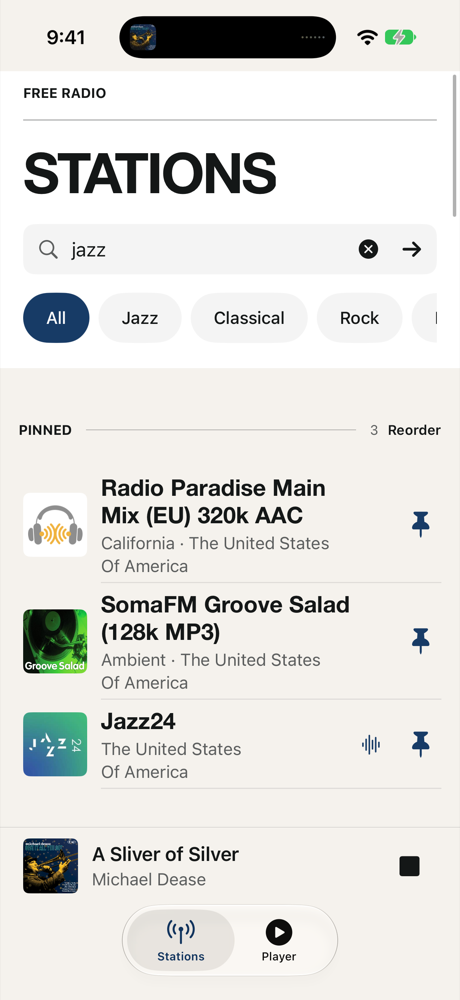

# Free Radio

A simple internet radio player for iPhone. Search thousands of stations from the community-run [Radio Browser](https://www.radio-browser.info) directory, pin your favourites, and see what's playing with album artwork.

<p align="center">
  
  
  
  
</p>

## Features

- **Search** Radio Browser by name, with quick genre filters.
- **Pin** stations from search results or the Player; long-press and drag (or tap Reorder) to sort them.
- **Now playing** titles from stream metadata (ICY/Shoutcast and HLS), with album art from [MusicBrainz](https://musicbrainz.org) and the [Cover Art Archive](https://coverartarchive.org). Falls back to station artwork.
- **Background audio** with lock-screen and Control Center controls.
- **Single Play/Stop control** — live radio has no meaningful pause.
- Swipe the Player sideways to get back to Stations.
- Relaunch restores your pins and last station without autoplaying.
- No accounts, no tracking, no ads of its own, no third-party dependencies.

## Requirements

- iOS 18 or later (iPhone)
- Xcode 16 or later

## Building

1. Clone the repo and open `FreeRadio.xcodeproj`.
2. To run on a device, create `Config/Local.xcconfig` (it's gitignored) with your Apple team ID:

   ```
   DEVELOPMENT_TEAM = ABCDE12345
   ```

   You may also need to change the bundle identifier (`dev.freeradio.app`) to one your team can register.
3. Pick a simulator or device and press ⌘R.

If you fork the app, set `FreeRadioMusicBrainzContact` in `Config/Info.plist` to your own contact URL or email — MusicBrainz requires it. See [docs/metadata-configuration.md](docs/metadata-configuration.md).

### Tests

```sh
xcodebuild test -project FreeRadio.xcodeproj -scheme FreeRadio \
  -destination 'platform=iOS Simulator,name=iPhone 17'
```

### Adding source files

The Xcode project is generated. After adding or removing Swift files outside Xcode, run:

```sh
python3 scripts/generate-project.py
```

## Missing a station?

Free Radio only knows about stations listed in Radio Browser. Anyone can add one at [radio-browser.info](https://www.radio-browser.info) — you need the station's direct stream URL, not its web player page.

## Docs

- [Build plan and status](docs/build-plan.md)
- [Implementation contracts](docs/implementation-contracts.md)
- [Metadata pipeline research](docs/metadata-pipeline-research.md)
